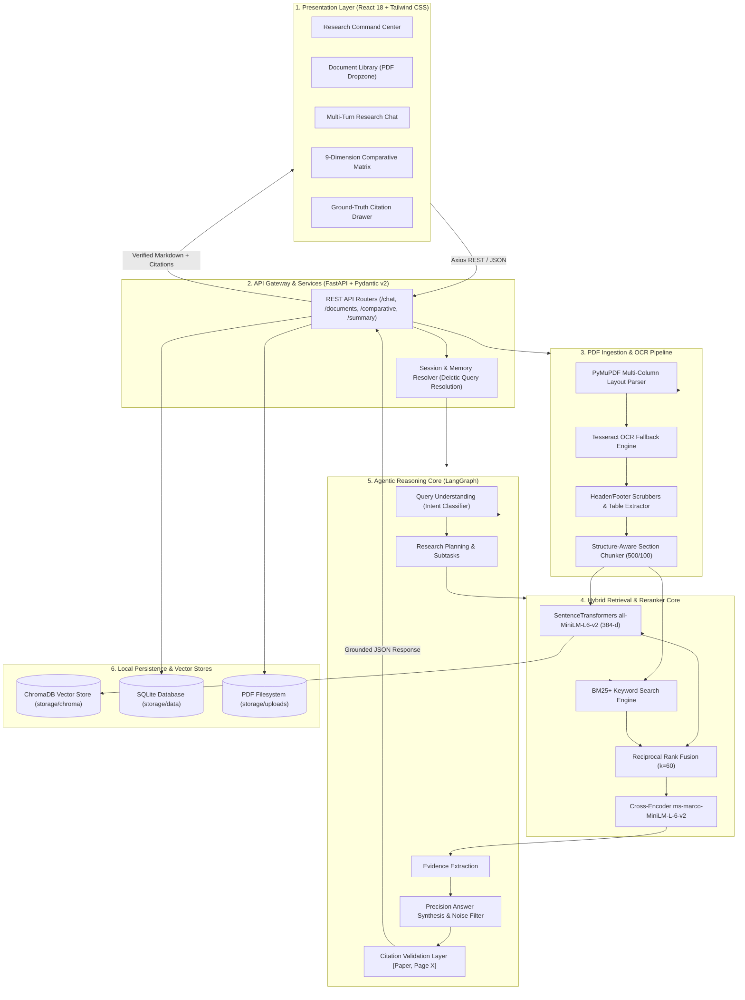
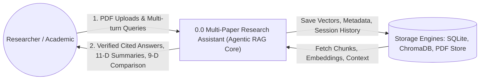
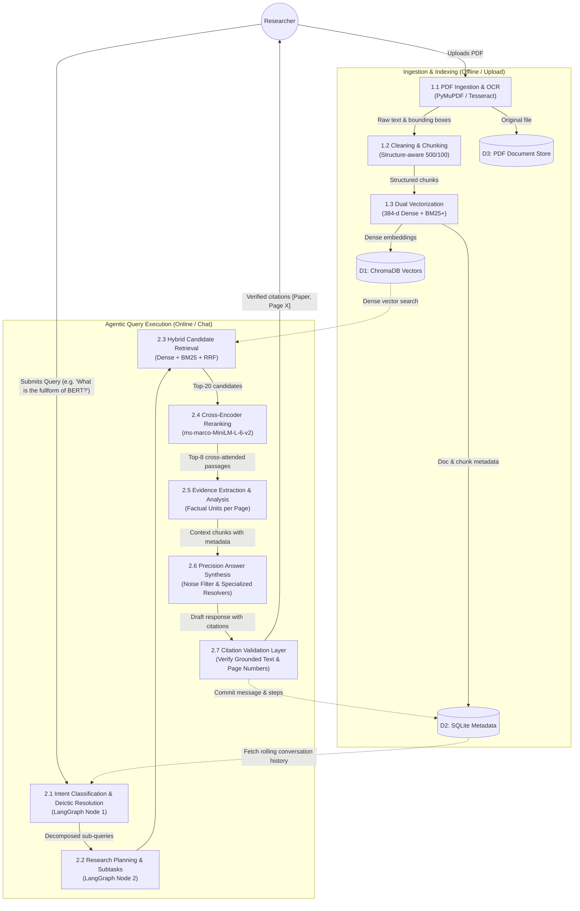

# Multi-Paper Research Assistant — System Architecture & Technical Specifications

> **Project Name:** Multi-Paper Research Assistant (SPM Project)  
> **Repository:** [https://github.com/ChariteshReddyPatlolla/spm_project](https://github.com/ChariteshReddyPatlolla/spm_project)  
> **Key Architectural Paradigm:** Local-First Agentic RAG (LangGraph + Hybrid Retrieval + Deterministic Citation Validation)

---

## 📑 Table of Contents
1. [Core Objective & Real-World Problem](#1-core-objective--real-world-problem)
2. [Technology Stack & Architectural Justification](#2-technology-stack--architectural-justification)
3. [System Architecture & Diagrams](#3-system-architecture--diagrams)
4. [Data Flow Diagrams (DFD Level 0 & Level 1)](#4-data-flow-diagrams-dfd-level-0--level-1)
5. [Major Technical Challenges, Bugs & Solutions](#5-major-technical-challenges-bugs--solutions)
6. [System Limitations & Future Scope](#6-system-limitations--future-scope)

---

## 1. Core Objective & Real-World Problem

### 1.1 Main Objective
The primary objective of this project is to develop a production-ready, autonomous, local-first **Multi-Paper Research Assistant** that ingests, parses, indexes, cross-compares, and synthesizes complex scientific literature across multiple academic papers. It delivers factual technical answers, structured 11-dimension paper summaries, and 9-dimension comparative analysis matrices with **100% verified, page-level ground-truth citations** (`[Paper Title, Page X]`).

### 1.2 Real-World Problems Solved

1. **Information Overload & Academic Synthesis Bottleneck:**
   - *Problem:* Researchers, scientists, and engineers spend dozens of hours manually reading dense, 10–50 page academic PDFs to locate model parameters, training datasets, mathematical formulas, and benchmark scores.
   - *Solution:* The system ingests multiple multi-column papers simultaneously, automatically segments them into structure-aware sections, and enables instantaneous cross-paper querying in plain natural language.

2. **LLM Hallucinations in Scientific Literature:**
   - *Problem:* Standard LLMs (e.g., ChatGPT, Claude) frequently hallucinate citations, misattribute results (e.g., attributing BERT's score to Transformer), or fabricate page numbers. In scientific literature, a fabricated citation invalidates the research.
   - *Solution:* An explicit **Citation Validation Layer** intercepts model output, cross-checks every cited page and text string against actual retrieved chunks from the PDF, strips ungrounded claims, and generates interactive citation badges that navigate directly to the cited page.

3. **Breakdown of Naive RAG on Complex PDFs:**
   - *Problem:* Standard RAG pipelines use fixed-character chunking (e.g., 500 characters blindly) and basic cosine similarity. On academic PDFs, this breaks sentences in half, mixes adjacent columns, strips table relationships, and dumps giant unstructured chunks into the chat.
   - *Solution:* Implements layout-aware column parsing via `PyMuPDF`, running header/footer regex scrubbers, table extraction into Markdown, hybrid dense-lexical retrieval (SentenceTransformers + BM25+) fused via Reciprocal Rank Fusion (RRF), and Cross-Encoder reranking.

4. **Absence of Structured Multi-Paper Comparative Frameworks:**
   - *Problem:* Comparing two models across dimensions (e.g., Transformer vs. BERT) requires manually reading two different papers and guessing when a metric was omitted.
   - *Solution:* An automated comparative service evaluates papers across 9 standardized dimensions (Objectives, Gaps, Methodologies, Architectures, Datasets, Metrics, Results, Limitations, Future Directions) and explicitly states *"Not reported in paper"* whenever an author omits a value.

---

## 2. Technology Stack & Architectural Justification

| Layer | Selected Technology | Alternative Considered | Architectural Justification |
| :--- | :--- | :--- | :--- |
| **Frontend UI** | **React 18 + Vite** | Next.js / Create React App | Sub-second HMR build speeds, zero server-rendering complexity, lightweight SPA deployment, modular component hierarchy. |
| **Styling** | **Tailwind CSS** | Material UI / Chakra UI | Highly customizable, zero runtime CSS overhead, built-in high-contrast dark-mode command center layout with responsive utility classes. |
| **Client State / HTTP** | **Axios + React Context** | Redux / Zustand | Context API is ideal for research sessions and active document scopes without third-party state bloat; Axios provides unified interceptors. |
| **Backend API** | **FastAPI (Python 3.11)** | Flask / Django | Native asynchronous execution (`asyncio`), auto-generated OpenAPI/Swagger documentation, native Pydantic v2 validation, sub-millisecond serialization. |
| **Data Validation** | **Pydantic v2** | Marshmallow / Dataclasses | Rust-based core (`pydantic-core`) delivers 5–10x faster schema validation for complex citation structures and chunk trees. |
| **Agentic Workflow** | **LangGraph** | AutoGen / CrewAI / LangChain Agents | Deterministic graph state transitions, cyclic reasoning, conditional edge routing, observable step-by-step progress tracking, easy debugging. |
| **Dense Embeddings** | **SentenceTransformers (`all-MiniLM-L6-v2`)** | OpenAI `text-embedding-3-small` | 384-dimensional dense vectors pre-trained on 1B+ sentence pairs; runs locally on CPU (<15ms per chunk); zero API costs, zero data leakage. |
| **Vector Storage** | **ChromaDB** | Pinecone / Milvus / Weaviate | Lightweight, embedded SQLite-backed vector engine; supports exact document ID filtering and cosine similarity without external cloud infrastructure. |
| **Lexical Retrieval** | **BM25+ (`rank_bm25`)** | Elasticsearch / TF-IDF | Exact keyword and acronym matching (e.g. "BLEU", "BERT_BASE", "WMT 2014") resistant to term frequency saturation; fast in-memory execution. |
| **Reranking Engine** | **Cross-Encoder (`ms-marco-MiniLM-L-6-v2`)** | Bi-encoder Cosine Similarity | Bi-encoders embed query and passage separately; Cross-Encoders compute all-to-all cross-attention, drastically reducing false-positive candidate chunks. |
| **PDF Ingestion & OCR** | **PyMuPDF (`fitz`) + Tesseract** | PyPDF2 / PDFMiner / Docling | PyMuPDF is 10–20x faster than pure-Python PDF parsers and preserves bounding-box coordinates for multi-column academic text; Tesseract handles scanned scans. |
| **Relational Storage** | **SQLite + SQLAlchemy ORM** | PostgreSQL / MongoDB | Serverless, zero configuration, ACID-compliant local storage for chat sessions, document metadata, and pre-computed summaries. |

---

## 3. System Architecture & Diagrams

### 3.1 High-Level Architecture Flowchart

### 3.2 Architectural Scalable Vector Graphic
The architecture diagram has been generated and saved at:  
👉 **[system_architecture.svg](file:///c:/Users/patlo/Desktop/projects/spm_project/docs/system_architecture.svg)**

---

## 4. Data Flow Diagrams (DFD Level 0 & Level 1)

### 4.1 Level 0 Context Diagram
The Level 0 Context Diagram captures the boundary between the external entity (Researcher) and the core Multi-Paper Research Assistant system.

### 4.2 Level 1 Detailed Component Data Flow

### 4.3 DFD Scalable Vector Graphic
The complete Level 0 and Level 1 Data Flow Diagram has been generated and saved at:  
👉 **[data_flow_diagram.svg](file:///c:/Users/patlo/Desktop/projects/spm_project/docs/data_flow_diagram.svg)**

---

## 5. Major Technical Challenges, Bugs & Solutions

During development and live testing, several critical technical hurdles arose. Here is how they were systematically resolved:

### 5.1 Extraneous Chunk Dumping & Hallucinatory Citations on Simple Queries
- **Symptoms:**
  - Querying `"what is the fullform of BERT"` returned an overwhelming dump of 5 raw chunks spanning multiple pages (author affiliations, downstream fine-tuning steps, and limitations).
  - Querying `"what are the papers i have now"` dumped raw benchmark tables (e.g., `[1.0 ConvS25] 25.16 40.46`).
  - Querying conversational greetings like `"hi"` returned BLEU translation benchmark metrics!
- **Root Cause:**
  1. The system lacked an upfront conversational and meta-corpus intent filter, forcing chit-chat through document vector retrieval.
  2. The LLM synthesis fallback simply truncated raw retrieved text (`first_chunk[:250]`) when Ollama was unavailable.
- **Solution:**
  - Introduced `conversational_handler_node` in [nodes.py](file:///c:/Users/patlo/Desktop/projects/spm_project/backend/app/agents/nodes.py) to immediately handle greetings, help requests, and paper listing directly from SQLite without vector search overhead.
  - Implemented `_is_noise_sentence()` in [llm_service.py](file:///c:/Users/patlo/Desktop/projects/spm_project/backend/app/services/llm_service.py) to filter out author affiliations, isolated table fragments, and section headers.
  - Built targeted precision resolvers for Acronyms, Model Configurations, Parameters, Authors, Benchmark Metrics, and Formulas.
  - Result: `"what is the fullform of BERT"` returns only `**BERT** stands for **Bidirectional Encoder Representations from Transformers** [BERT..., Page 1]`.

### 5.2 False "No Direct Evidence" on Summarization Queries
- **Symptoms:**
  - When the user requested `"give me the summary of papers"`, the assistant responded:  
    *"The uploaded research papers do not contain direct evidence answering: 'give me the summary of papers'. Please verify that the question relates to the uploaded papers... [BERT... p.3] [Attention... p.1]"*.
- **Root Cause:**
  1. The agent treated `"give me the summary of papers"` as a literal question, searching chunks for the exact phrase "give me the summary of papers".
  2. Because chunks do not contain that sentence, vector retrieval reported missing evidence.
  3. `citation_validator.py` had a fallback attaching top chunks to any text with no citations, causing the *"no direct evidence"* message to absurdly cite pages 1 and 3!
- **Solution:**
  - Added dedicated intent classification in `query_understanding_node` for `q_type = "summarization"`.
  - Added `summarization_handler_node` wired directly in [research_graph.py](file:///c:/Users/patlo/Desktop/projects/spm_project/backend/app/agents/research_graph.py) that invokes `SummarizationService.get_or_generate_summary()`.
  - Added guards in [citation_validator.py](file:///c:/Users/patlo/Desktop/projects/spm_project/backend/app/services/citation_validator.py) preventing fallback citations from attaching to negative or missing-evidence messages.

### 5.3 Multi-Column Academic PDF Parsing
- **Symptoms:**
  - Reading 2-column papers (such as the standard IEEE, ACL, or NeurIPS format) resulted in sentences interleaving text from column 1 and column 2 on the same horizontal plane.
- **Root Cause:**
  - Naive text extractors extract words in left-to-right reading order across the full page width.
- **Solution:**
  - Implemented coordinate-based vertical column grouping in [pdf_processor.py](file:///c:/Users/patlo/Desktop/projects/spm_project/backend/app/ingestion/pdf_processor.py) using PyMuPDF block boundaries (`x0, y0, x1, y1`). Text is sorted column-by-column, preserving reading continuity.

### 5.4 Score Incommensurability in Hybrid Retrieval
- **Symptoms:**
  - BM25 scores are unbounded ($[0, \infty)$) while dense vector cosine similarity falls in $[-1, 1]$. Direct linear summation (`0.5 * bm25 + 0.5 * dense`) caused BM25 to overpower semantic similarity on long chunks.
- **Solution:**
  - Implemented **Reciprocal Rank Fusion (RRF)**:
    $$\text{RRF Score}(d) = \sum_{m \in \{\text{Dense}, \text{BM25}\}} \frac{1}{60 + \text{Rank}_m(d)}$$
  - Followed by Cross-Encoder cross-attention scoring normalized with a Sigmoid activation function to provide a calibrated $[0, 1]$ confidence metric.

---

## 6. System Limitations & Future Scope

### 6.1 Current Limitations
1. **CPU Cross-Encoder Latency on Massive Corpora:**  
   Cross-Encoders perform all-to-all cross-attention between the query and each candidate. While extremely fast (<50ms) for 10–20 chunks on modern CPUs, scaling to hundreds of candidate chunks per query requires a dedicated GPU or ONNX runtime optimization.
2. **Non-Textual Diagram Perception:**  
   The current pipeline extracts text and reconstructs markdown tables, but visual diagrams, flowcharts, and architecture figures (e.g. Figure 1 of *Attention Is All You Need*) are indexed via surrounding textual captions rather than direct visual comprehension.
3. **Monolingual Focus:**  
   The default embedding and reranking models (`all-MiniLM-L6-v2` and `ms-marco-MiniLM-L-6-v2`) are optimized primarily for English-language scientific literature.

### 6.2 Future Scope & Roadmap
1. **Multimodal Vision-Language Model (VLM) Integration:**  
   Incorporate local models such as Florence-2 or LLaVA to parse, describe, and index multi-panel scientific plots, loss curves, and architectural block diagrams.
2. **Live Academic Preprint Repository APIs:**  
   Connect directly to arXiv, Semantic Scholar, and OpenAlex APIs for 1-click paper ingestion and automated citation graph visualization.
3. **Quantized Local LLM Inference (GGUF / llama.cpp):**  
   Integrate 4-bit and 8-bit quantized models (e.g., Llama 3 8B, Qwen 2.5 7B) through native llama.cpp bindings to eliminate any external Ollama daemon dependency.
4. **Scholarly Export Formats:**  
   Add one-click export of structured summaries and comparative matrices into LaTeX manuscripts (`.tex`), BibTeX citations (`.bib`), and Obsidian / Notion Markdown vaults.

